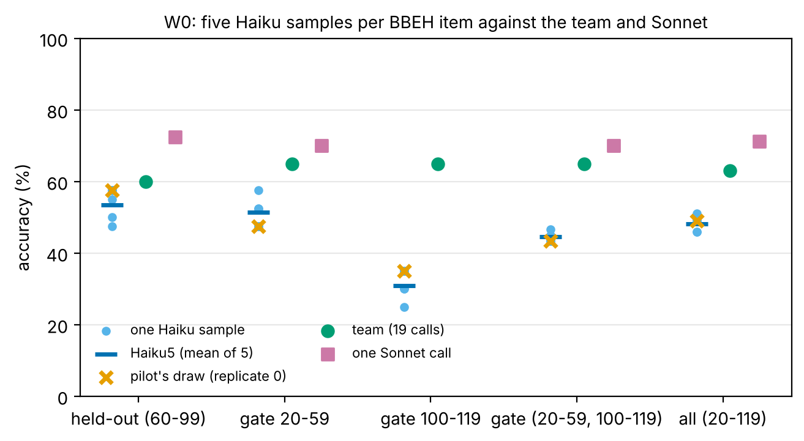
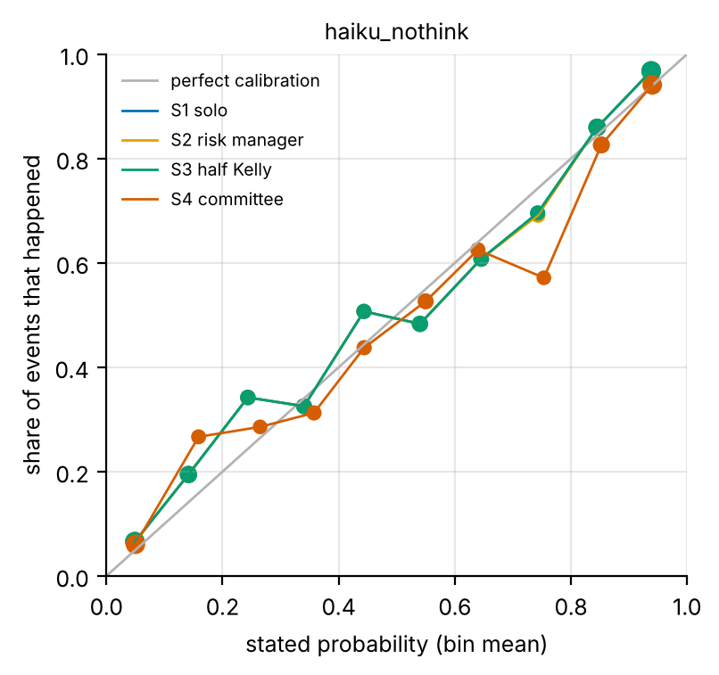
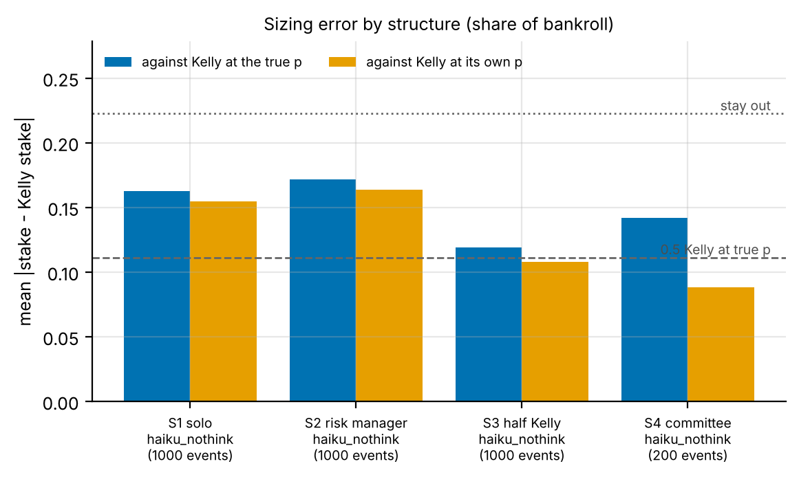
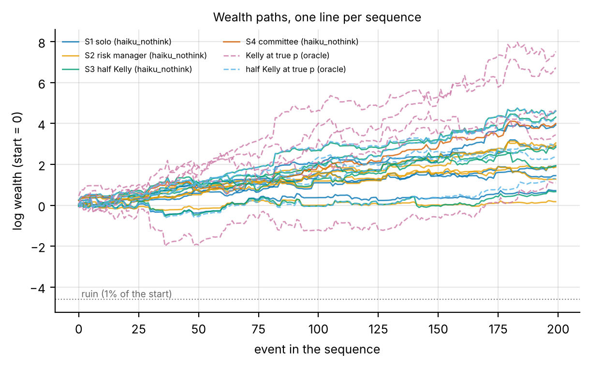
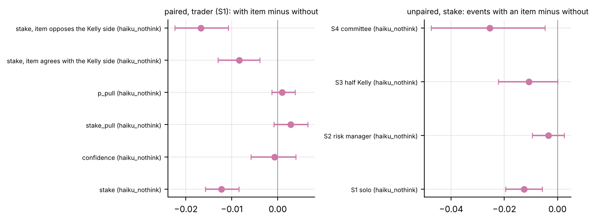

# AutoAgentNetwork v3, session S1: data sources, the W1 band check, W0 and W2-A

2026-10-20 · branch `v3_s1` · plan `research/v3/program.md` · steering `research/STEERING.md` (eleventh entry) · audits 38 onward in `research/audit_log.md`.

## Summary

- **Data.** Every workstream has a source:
    - W1: BBEH positions 120 onward, a replication on untouched items. MathArena fails freshness, LiveBench has no licence, and HLE's gate refuses access.
    - W2-B: ForecastBench sets due after the June 2026 cutoff.
    - W3b: ABIDES.
    - W4: the official A2A and MCP SDKs.
- **W1 band.** One Haiku call scores 49% (33 to 65%) on BBEH 120-139, inside the 25-65% band.
- **W0.** On the clean held-out items, the team minus the five-sample Haiku mean is +6.5 points (-8.0 to +20.0): unresolved. The team is level with a free majority vote (+1.2) and below one Sonnet call.
- **W2-A.**
    - With room to work, Haiku computes the Bayesian probability almost exactly (belief error 0.005), but stakes about a quarter of Kelly.
    - A fixed half-Kelly rule on its probability closes 85% of the gap to half Kelly at the true probability (sizing error 0.73x, 0.72 to 0.75) and raises log growth by +0.0034 per event (+0.0014 to +0.0055).
    - It misses the preregistered two-thirds bar, which even half Kelly at the true probability cannot meet, so by rule the solo trader stands.
    - A risk manager makes underbetting worse (1.06x).
    - A news item with no information lowers the stake by 0.012 of bankroll (-0.016 to -0.008) without moving the probability. That is a miss of the registered prediction, and it rests on one quote template with no placebo.
- **Spend.** $1.82 in S1; $11.13 of the pilot phase's $20.

## 1. Data-source ladders

Every workstream's ladder was probed top-down with the free checks: reachable, licensed, gradable, big enough, fresh. The code is `autoagentnet/ladder/`, with offline tests in `tests/test_ladder.py`; the full record, one row per rung tried, is `research/v3/data_sources.md`.

**The freshness cutoff.** Anthropic's model pages give "Training data cutoff: Jun 2026" for both `claude-haiku-5-5` and `claude-sonnet-5-5`, with no day. An item counts as fresh only if it is dated 2026-07-01 or later (`research/lit/v3_sources.md`, section 1).

| Workstream | Chosen rung | Why the higher rungs failed |
| --- | --- | --- |
| W1 | 4: BBEH, positions 120 onward | 1, MathArena 2026: only 93 of 362 gradable items are dated after June 2026 (minimum 120). 2, LiveBench: no data licence, and the newest public release is 2024-11-25. 3, HLE: gated, and Kevin's HF account is not on its access list (HTTP 403). |
| W2-B | 1: ForecastBench, question sets due after the cutoff (3,901 resolved yes/no items) | none |
| W3b | 1: ABIDES, installed without its version pins; 2-agent smoke test with our caller passed | none |
| W4 | 1: official A2A SDK 1.2.3 + MCP SDK 2.3.0; 2-agent smoke test over JSON-RPC with an MCP tool passed | none |

- **BBEH is fresh only by its canary.** It was published 16 months before the cutoff, and no Anthropic statement confirms that canary-marked data is left out of training. Audit 38 therefore calls W1 on BBEH a replication on untouched items of the pilot's four tasks, not "fresh public data".
- **ForecastBench uses only question sets due after the cutoff** (audit 38). The model's training data runs past the due date of earlier sets, so it may know part of their answers.
- **Hand checks.** BBEH 10 of 10 golds agree; ForecastBench 10 of 10 checkable golds agree, against Yahoo, DBnomics and Kalshi.
- **Kalshi and Polymarket** are reachable but fail the licence check: their terms pages could not be read. **KalshiBench v2** states no licence and is stale.

## 2. W1 band check (BBEH 120-139)

`configs/experiments/v3/w1_band_bbeh.yaml`: one Haiku call, 5 samples per item, on the rung's 20 calibration items (100 calls).

- **Result.** 49% correct (95% item bootstrap 33 to 65%). That is inside the 25-65% band, so BBEH 120+ is W1's data source.
- **Run facts.** $0.0688; 100% parsed, none truncated.
- **By task:** boolean expressions 49%, dyck 40%, geometric shapes 35%, web of lies 60%.
- **Miss.** The interval came out ±16 points against the predicted ±12.

## 3. W0: the control resample

Plan amendment 7 (`research/plan.md`, rules 66-73) re-sampled the pilot's single-Haiku control four more times on BBEH validation items 20-119. The write-up is section 3.7 of the pilot report (`reports/pilot/report.md` and `.pdf`, generated by `analysis/w0.py`).

**The run.**

- 400 new single-Haiku calls on BBEH positions 20-119; replicate 0 is the pilot's own call, from the cache.
- $0.2785; 100% parsed, none truncated. Audits 38 and 39.

**Held-out 60-99, the only item set chosen without selection.**

- Team minus Haiku5 (the mean of five samples) is **+6.5 points (95% -8.0 to +20.0)**: rule 69's "unresolved".
- With the four new samples only (Haiku4) it is +7.5, the same branch.
- A free majority vote over the five samples, reported but not preregistered, scores 58.8%. Team minus vote is **+1.2 (-15.0 to +17.5)**.
- One Sonnet call scores 72.5%, 12.5 points above the team, at $0.0147 against the team's $0.0118 per item.

**The pilot's lucky draw explains part of the drop, not all of it.**

- On 60-99 the draw was +5.0 points above Haiku4; on 20-59 it was -5.0.
- Against the whole gate (20-59 and 100-119), the drop in team minus single is 19.2 points with the draw and 13.8 with Haiku5, so the draw explains about 5 points.
- Items 100-119 carry most of the rest: team minus Haiku5 there is +34 points, with Haiku5 at 31%.
- On all 100 items team minus Haiku5 is +14.8 (6.0 to 24.2). Sixty of those items are gate items, so this is not a headline.

**What it means.** At n = 40 the smallest detectable difference is about 20 points. W0 points one way and weakens the premise: on the clean items the team is level with a free vote and below one Sonnet call. Only W1, with about 240 sealed items and the vote as an arm, can settle it.

Each dot is one Haiku sample; the bar is the five-sample mean, the cross the pilot's draw, the circle the team and the square one Sonnet call, by item set.

## 4. W2-A: the conviction desk (synthetic, known truth)

**The question.** When an LLM trader decides how much to bet, does an organizational structure (a risk manager, a mechanical sizing rule or a committee) bring its stakes closer to the stake that maximizes long-run wealth? And does an emphatic news item that carries no information change the stake? The full prereg, with every term defined, is `research/v3/plan_w2.md`; the code is `autoagentnet/desk/` and `analysis/desk.py`, with 25 offline tests in `tests/test_desk.py`.

**The setup, in plain words.**

- **The events.** Each event comes with a base rate and three clues of known accuracy, so its true probability p is a computable Bayesian posterior.
- **The price.** The market posts a price q that uses the base rate, part of what the clues say, and random noise.
- **The best stake.** The *Kelly stake* is the share of bankroll that maximizes expected log wealth at the true p.
- **The structures.**
    - S1: the trader alone, choosing its own p, side and stake.
    - S2: the trader, then a risk manager who sees p, the price and the track record, never the clues, and sets the final stake.
    - S3: the trader's p, then a fixed rule that stakes half Kelly at that p.
    - S4: a committee of six whose pooled p is staked at half Kelly.
- **The salience test.** About half the events carry a named person's emphatic quote favouring a side picked by a fair coin, so the quote carries no information. On those events the trader is also asked a second time without the quote (the *twin*), which gives a paired with-minus-without difference on the same event.
- **The measures.**
    - *Belief error*: mean |p - true p|.
    - *Sizing error*: mean |stake - Kelly stake at the true p|, as a share of bankroll.
    - *Log growth*: mean log(wealth after / wealth before) per event.

**The runs (Haiku 5.5, thinking off, working allowed, 800 output tokens).**

| Run | Events | Calls | Cost | Format |
| --- | --- | --- | --- | --- |
| two smoke tests (20 events each) | 40 | 40 | $0.0107 | smoke 1 truncated at 400 tokens, which led to the re-sizing |
| tuning, sequence 1 (one revision allowed, none needed) | 200 | 1,449 | $0.4243 | 1 trader reply truncated |
| sealed sequence 101 (S1-S4, twins) | 200 | 1,462 | $0.428 | all parsed |
| sealed sequences 102-105 (S1-S3, twins) | 800 | 1,852 | $0.6061 | trader 4 of 800 truncated, risk 1 of 638 |

- **S4 was descriptive.** On tuning, pooling raised belief error (0.0090 against S1's 0.0054), so by the preregistered rule S4 ran on sequence 101 only and is not judged.
- **No sealed outcome was read until both sealed runs were in.** The block was then judged once.
- **Auditors.** Every paid run was audited (audits 40-46). Smoke test 1 was audited only after smoke test 2, a logged process miss (audit 41).

**Finding 1: with working allowed, Haiku knows p almost exactly, so this is a sizing problem.**

- Belief error is 0.0049 and ECE 0.039.
- This holds only because the trader may work through the numbers. In smoke test 1, before working was allowed (400 tokens), belief error was 0.056, though on only 12 complete replies (audits 41 and 45).
- Bias is -0.003.
- Only 9 of 248 bets placed at 90% or more lost (3.6%).
- These numbers sit far from the registered anchors (ECE 0.08-0.20, false conviction 20-35%, taken from KalshiBench). Those anchors describe forecasting real events, not the arithmetic of a stated prior and stated clue accuracies. Once working was allowed after smoke test 1, the misses were logged before the seal.

Stated p against the share of events that happened, in ten bins. S1, S2 and S3 share the trader's p, so their lines coincide; S4 covers 200 events.

**Finding 2: the solo trader stakes about a quarter of Kelly. A fixed half-Kelly rule closes most of the gap; a risk manager widens it.**

| Structure | Events | Sizing error (true p) | Ratio to S1 | Gap to half Kelly closed | Log growth per event | Difference from S1 |
| --- | --- | --- | --- | --- | --- | --- |
| S1 solo | 1,000 | 0.162 | 1 | 0 | 0.0109 | |
| S2 risk manager | 1,000 | 0.172 | 1.06 (1.04 to 1.07) | -18% | 0.0093 | -0.0016 (-0.0036 to +0.0004) |
| S3 half Kelly on own p | 1,000 | 0.119 | 0.73 (0.72 to 0.75) | 85% | 0.0144 | +0.0034 (+0.0014 to +0.0055) |
| S4 committee (descriptive) | 200 | 0.142 | 0.84 (0.80 to 0.88) | 49% | 0.0200 | +0.0055 (+0.0016 to +0.0095) |
| half Kelly at the true p (benchmark) | 1,000 | 0.111 | 0.69 | 100% | 0.0156 | |
| staying out (benchmark) | 1,000 | 0.223 | 1.37 | | 0 | |

- **The solo trader underbets.**
    - Median stake over Kelly is 0.26 (where |Kelly| > 0.05); the mean stake when betting is 0.077.
    - Only 18 of 1,000 decisions overbet, 4 of them on the wrong side.
- **S2, the risk manager, cuts stakes further.** It stakes 0.066 when betting, so it adds caution to a trader that already has too much.
- **S3, the mechanical rule, closes 85% of the gap** between S1 and half Kelly at the true p, and raises log growth by a third.
- **Rule 1 recommends no structure, and S1 stands.**
    - A structure qualified only if its sizing error was at most two thirds of S1's.
    - S3 reaches 0.73 and misses only that condition.
    - Audit 43 noted before the seal that even half Kelly at the true p reached only 0.71 on tuning; on the sealed block it reaches 0.69. "S1 stands" is therefore a property of the threshold, not evidence against S3.
- **S4 is descriptive.**
    - It ran on sequence 101 only.
    - Its pooled p doubles belief error (0.0100 against S1's 0.0046 on the same events).
    - Every member was less accurate than the trader: belief errors 0.006 to 0.029.
    - The worst were members 4 and 5, who lean toward the price by instruction, a caveat logged before the seal (audit 42).

Mean |stake - Kelly stake| per structure: against Kelly at the true p (decides) and at the structure's own p (reported only). Dotted line: staying out. Dashed line: half Kelly at the true p.

**Finding 3: wealth.** No sequence was ruined under any structure. Over 200 events, S3's mean final wealth is 40 times the start, against S1's 16 and S2's 10. Full Kelly at the true p grows fastest (0.0235 per event) but swings widest.

Log wealth along each sealed sequence. Solid lines are the structures; dashed lines are full and half Kelly at the true p.

**Finding 4: a news item with no information lowers the stake without moving belief.**

On 518 paired events, the same trader on the same event, with the item minus without it:

| Measure | Effect (95% interval) |
| --- | --- |
| stake (share of bankroll) | -0.0122 (-0.0158 to -0.0085), from 0.068 without the item: about 18% lower |
| stake moved toward the item's side (stake_pull) | +0.0028 (-0.0009 to +0.0066) |
| p moved toward the item's side (p_pull) | +0.0010 (-0.0013 to +0.0038) |
| *exploratory:* bet rate | -0.085 (-0.114 to -0.054): 55 pairs where only the call with the item stays out, 11 where only the twin does |
| *exploratory:* stake, where both calls bet (380 pairs) | -0.0121 (-0.0166 to -0.0074) |
| *exploratory:* confidence, where both calls bet | -0.0007 (-0.0058 to +0.0040) |
| *exploratory:* stake, item opposes / agrees with the Kelly side | -0.0167 / -0.0084; difference +0.0083 (+0.0012 to +0.0153) |
| *exploratory:* belief error | +0.0009 (-0.0014 to +0.0036) |

- **The direction was preregistered as a miss.** Rule 2a reads this as "consistent with the item lowering conviction", a miss of prediction 7, which expected the item to raise the stake. That prediction extended the naming effect of *Confidence Without Competence*; it was not a replication.
- **What moves is sizing, not belief.**
    - p does not move.
    - The trader stays out more often, and when it does bet, it stakes less at the same stated confidence.
- **Rule 2b finds no evidence that the item pulls the stake toward its own side.**
    - The stake does fall more where the item opposes the Kelly side.
    - That contrast was not registered, and it measures the same pull, so it stays exploratory (audit 45).
- **One item, no placebo.**
    - All 521 items use the same quote ("I have never been so sure of anything ... It will (not) happen"); only the name, role and scene vary.
    - The twin drops the text entirely; there is no neutral-text placebo.
    - So this is the effect of this item, or possibly of any added text. It is not a general salience effect.

Left: paired effects on the trader (S1). Right: unpaired stake effects per structure (events with an item minus events without). The unpaired effects also carry differences between the event sets. On sequence 101, for example, |Kelly| averages 0.217 on events with an item and 0.243 on those without, which could account for about half of S4's unpaired effect (audit 45). Only the paired effects are read.

**The scorecard** (`research/v3/plan_w2.md`) scores 29 rows of registered predictions:

- 13 hits, 11 misses, 2 mixed and 1 not testable.
- In 2 more, the point estimate falls inside the range but the interval spans 0.
- Five of the misses were logged as likely before the seal: ECE, belief error, false conviction, anchoring and cost per call.
- The 2 mixed rows are the agree-versus-oppose ordering and the cost per sequence.
- The other six:
    - calibration does not lean overconfident at both tails;
    - most overbets are oversized, not wrong-side;
    - pooling raised belief error;
    - S4's growth exceeds the registered 0.0156 (its own sequence's half Kelly is 0.0212);
    - the salience stake effect is negative;
    - the design cost $1.03 instead of $2.3, because S4 ran on one sequence.

**Caveats.**

- **The events are synthetic, with stated numbers.** Real forecasting (W2-B on ForecastBench) puts the difficulty in the belief, which here was nearly free.
- **One model.** The Sonnet arm is below.
- **The prompts are placeholders,** with recorded hashes.
- **Working allowed.** Finding 1 depends on it (smoke test 1, without room to work, had belief error 0.056 on 12 complete replies).
- **S5 was deferred.** S5 is program.md's market of bankrolled traders in the auction engine; it is not in the preregistered set S1-S4.
- **The analysis changed after the seal, twice, and only in what it describes.**
    - The twin table's confidence means now use the same pairs as the effect.
    - The exploratory tables above were added (audit 45).
    - No registered effect, interval or decision changed.

**The Sonnet arm was not run** (audit 45).

- Its prereg named no decision, and the protocol rules out such runs.
- Its cost prediction ($1.0) was less than half the projection (about $2.28).
- Without twins, and with a noisy ECE on 200 events, it would have changed nothing.
- Sonnet returns only inside a W2-B decision.

**What would make W2-A informative about beliefs.**

- Run a harder-belief arm (about $1.5): Haiku without room to work, on a fresh tuning sequence plus sealed sequences 106-110, with S1, S3, S4 and twins.
- Smoke test 1 hints at belief error near 0.056 there, though on only 12 complete replies. If that holds, calibration, pooling and the item's pull on p become testable; its tuning sequence would check it first.

## 5. Spend

All S1 calls were Haiku 5.5 on the Anthropic account. The ledger is in `state/`, and every run's checkpoints are on origin.

| Workstream | Run | Calls | Cost |
| --- | --- | --- | --- |
| W1 | band check, BBEH 120-139 | 100 | $0.0688 |
| W0 | control resample | 400 | $0.2785 |
| W2-A | two smoke tests | 40 | $0.0107 |
| W2-A | tuning, sequence 1 | 1,449 | $0.4243 |
| W2-A | sealed sequence 101 | 1,462 | $0.4280 |
| W2-A | sealed sequences 102-105 | 1,852 | $0.6061 |
| **S1 total** | | **5,303** | **$1.8164** |

- **Lifetime spend** is $11.13: Anthropic $11.1215, OpenAI $0.0069.
- **The pilot phase** caps lifetime spend at $20, so $8.87 is left.
- **No run came near its caps.**
    - The largest was $0.61, against the $4 run cap.
    - No run was stopped by a kill rule.
- **W2-A cost $1.47 in total,** against program.md's $3-6 for A and B with Sonnet arms. The Sonnet arm was not run.
- **Deadlines.** The Anthropic credit expires on 2026-11-01, and the current key on 2026-11-18.

## 6. What Kevin must set up or decide

1. **The v3 budget phase.** The active phase is still `pilot` ($20 in total). S1 ran inside it; W1 at power and W3-W4 need the proposed `v3` phase (program.md: total 50 USD, 4 USD per run). Only Kevin edits the budget file.
2. **W1's data, a choice.** Either BBEH, framed as a replication on untouched items (fresh only by its canary; audit 38), or HLE. HLE would outrank BBEH, but needs access: request it for `cais/hle` with the Hugging Face account behind `HF_TOKEN`, which the gate currently refuses ("not in the authorized list"). At power W1 needs about 240 sealed items, with the five-sample vote as an arm (audit 39).
3. **Network and accounts.**
    - github.com web pages and the API are blocked for repositories outside this session, but `git clone` works (enough for ABIDES and Magentic).
    - The Metaculus API now needs a token, and en.wikipedia.org answered HTTP 403. Only the ForecastBench hand check needed them.
    - Kalshi's and Polymarket's terms could not be read (a 429 and an empty page). Confirm research use, or leave both rungs failed; ForecastBench covers W2-B.
4. **OpenAI arms.** Not used in S1; they still need your OK (program.md decisions).
5. **The confidence paper.** The full text of *Confidence Without Competence* (SSRN 6896281) was not reachable (403). Its results table would turn the W2 salience prediction from a guess into an anchor.
6. **Confirm STEERING entries 1-11**, and the readings of the S1 audits (38-45) in `research/audit_log.md`.
7. **The Anthropic credit expires on 2026-11-01.** S2 (W2-B, then W1) should run before then, and needs the v3 phase first. Please set it now, and cap W2-B at about $2 so that W1, the only test of the team premise, still fits (audit 46).
8. **Optional: the harder-belief W2-A arm** (about $1.5, audit 45).
    - Design: Haiku without room to work, on a fresh tuning sequence and sealed sequences 106-110.
    - It would make calibration, pooling and the item's pull on beliefs testable.
    - It needs your OK, because S2 is W2-B and W1.
    - Sonnet returns only inside a W2-B decision.

## 7. The uploaded plan doc against program.md

Kevin's upload `AutoAgentNetwork_v3_Realistic_Agent_Organizations.docx` matches `research/v3/program.md` in substance. The differences are extraction artifacts (the Haiku5 subscript, the × sign, the tau2 glyph, the minus signs in the f* formula) and three doc-only lines:

- the note that sessions read the repo copy;
- a link titled "AutoAgentNetwork pilot review and market town replay";
- "in KevinChunye/AutoAgentNetwork".

Per program.md, program.md and STEERING govern.

Two corrections to program.md surfaced in S1:

- ForecastBench's datasets are CC BY-SA 4.0 (only its code is MIT).
- The W2 salience test is an extension of the naming effect, not a replication (`research/lit/w2_confidence.md`).
